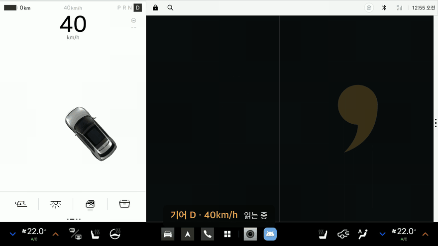
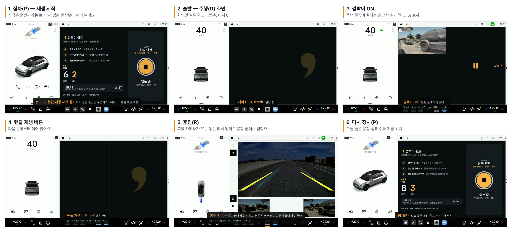
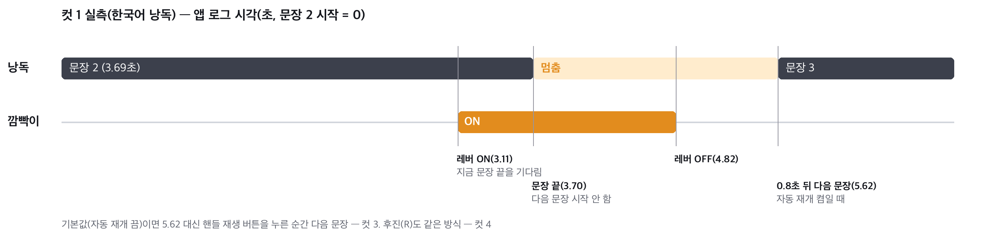
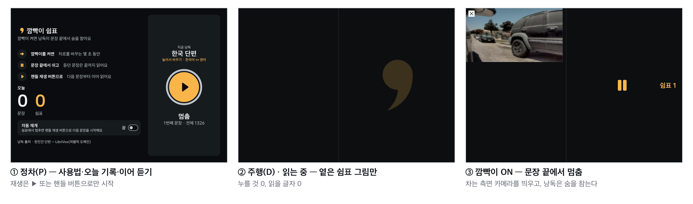

# 깜빡이 쉼표 (Blinker Comma)

**차로를 바꾸거나 후진하는 순간, 차 안 낭독이 듣던 문장 끝에서 숨을 참았다가 — 핸들 버튼 한 번에 다음 문장부터 이어 줍니다.**

현대자동차그룹 차량용 앱 개발 공모전(Pleos Connect) 출품작입니다. 판단 규칙은 다른 오디오 앱에도 그대로 붙일 수 있는 「쉼표 규칙」 엔진으로 분리돼 있습니다.



<sub>Pleos Connect 에뮬레이터 실제 구동 화면(10초, 소리 없음). 아래 자막의 「앱 로그」는 그 순간 앱이 남긴 로그 줄입니다.</sub>

| 바로 가기 | |
|---|---|
| 서명된 APK 내려받기 | [Releases · v1.0-submission](../../releases/tag/v1.0-submission) · 저장소 안 [`apk/`](apk/) |
| 5분 안에 돌려 보기 | [2. 실행 방법](#2-실행-방법) |
| 다른 오디오 앱에 붙이기 | [`docs/INTEGRATION.md`](docs/INTEGRATION.md) |
| 규칙 전문 | [`docs/SPEC.md`](docs/SPEC.md) (원칙 11개 · 쉼표 규칙 R1~R11) |

---

## 1. 어떤 앱인가요

### 이런 순간을 위해 만들었습니다

오디오북이나 어학 낭독은 문장 하나를 놓치면 뜻이 끊깁니다. 그런데 운전 중에는 **차로를 바꾸거나 후진할 때처럼 주의가 몰리는 몇 초**가 하루에도 여러 번 옵니다.
차는 그 순간을 압니다 — 운전자가 깜빡이를 켜고, 기어를 R에 넣으니까요. 깜빡이 쉼표는 그 신호를 받아 **듣던 문장을 끝까지 읽고 멈춘 뒤, 운전자가 고를 때 다음 문장부터** 읽습니다.

### 한눈에 보는 사용 흐름



### 차가 주는 신호와 앱이 하는 일

| 차가 주는 신호 | 앱이 하는 일 |
|---|---|
| **깜빡이 ON** (달리는 중) | 지금 문장 끝에서 멈춥니다. 2.5초 안에 안 끝나면 그 자리에서 멈추고, 재개할 땐 그 문장 처음부터 |
| **기어 R** (후진) | 레버 없이도 지금 문장 끝에서 멈춥니다. 후진하는 동안엔 버튼을 눌러도 기다립니다 |
| **신호 대기** (차속 0.3m/s 이하) | 깜빡이를 켜도 멈추지 않습니다 — 출발하는 순간부터 예약 |
| **핸들 재생 버튼** | 다음 문장부터 이어 읽습니다 (기본값) |
| **레버 OFF 0.8초** | 버튼 없이 이어 읽습니다 (정차 화면에서 「자동 재개」를 켰을 때) |
| **안내 음성 등 다른 소리** | 잠깐 양보했다가 끝나면 이어 읽습니다 |



### 지키는 원칙

- **주행 중 화면 조작 0** — 달리는 동안 화면엔 옅은 쉼표 그림과 ⏸ 표시뿐입니다. 설정과 기록은 정차(P) 화면에서만 봅니다.
- **차량 제어 0** — 신호를 읽기만 합니다. 네트워크·계정도 쓰지 않습니다.
- **앱이 스스로 소리를 다시 내지 않습니다** — 다시 듣는 순간은 운전자가 고릅니다(기본값: 핸들 재생 버튼).
- **이어 듣기** — 시동을 껐다 켜도 마지막 문장부터 이어 갑니다.



### 들어 있는 낭독

사람이 읽은 퍼블릭 도메인 녹음(LibriVox, Public Domain Mark) 2팩이 앱에 들어 있습니다. 정차 화면에서 팩 제목을 누르면 바뀝니다.

| 팩 | 길이 | 출처 |
|---|---|---|
| 한국어 — 현진건 단편 「피아노」 「술 권하는 사회」 「빈처」 (기본) | 약 68분 · 1,326조각 | [`packs/hyun/CREDITS.txt`](app/src/main/assets/packs/hyun/CREDITS.txt) |
| 영어 — The Aesop for Children | 약 62분 · 1,066조각 | [`packs/aesop/CREDITS.txt`](app/src/main/assets/packs/aesop/CREDITS.txt) |

---

## 2. 실행 방법

### 가장 빠른 길 — 서명된 APK 설치

1. [Releases](../../releases/tag/v1.0-submission)에서 `CommaLane_blinker-comma_release.apk`를 받습니다(저장소 [`apk/`](apk/)의 파일과 같습니다).
2. Pleos Connect 에뮬레이터를 켜고 설치·실행합니다. 에뮬레이터에서는 **사용자 10**에서 앱이 돕니다.
   ```bash
   adb install CommaLane_blinker-comma_release.apk
   adb shell am start --user 10 -n app.blinkercomma/.MainActivity
   ```

### 직접 빌드

```bash
export JAVA_HOME=$(/usr/libexec/java_home -v 21)   # JDK 21 (25는 Gradle 8.13과 맞지 않습니다)
./gradlew :app:assembleDebug
adb install app/build/outputs/apk/debug/app-debug.apk
adb shell am start --user 10 -n app.blinkercomma/.MainActivity
```

### 써 보기 — 4단계

| 순서 | 할 일 | 보이는 것 |
|---|---|---|
| 1 | 첫 실행에 뜨는 권한 안내에서 **[허용]** → 시스템 창 **「허용」** | 차 속도 권한이 「위치 정보」로 표시됩니다. 거부해도 깜빡이·기어만으로 동작합니다 |
| 2 | 정차(P) 화면에서 **▶** | 낭독이 시작됩니다. 앱이 스스로 재생을 시작하지는 않습니다 |
| 3 | Virtual Console에서 **기어 D · 속도 40** | 화면이 어두운 주행 화면으로 바뀝니다 |
| 4 | Virtual Console에서 **깜빡이 BlinkRight** | 듣던 문장이 끝나는 순간 멈추고 ⏸ — 핸들 재생 버튼으로 다음 문장부터 |

> 에뮬레이터 Virtual Console에는 핸들 미디어 키 카드가 없어서, 핸들 재생 버튼은 `adb shell input keyevent 85`로 넣습니다.

---

## 3. 테스트 환경 · 설정

| 항목 | 값 |
|---|---|
| 에뮬레이터 | **Pleos Connect 에뮬레이터 2.1.0** · Android API 34 |
| 화면 규격 | **2560×1440** (앱 창 1682×1210dp) |
| 사용 SDK | Pleos Vehicle SDK 2.3.2 — `TurnSignal`(깜빡이) · `Gear`(기어) / AAOS `CarPropertyManager` — `PERF_VEHICLE_SPEED`(차속) / MediaBrowserService · MediaSession(핸들 키·시스템 미디어 소스) / AudioManager(오디오 포커스) |
| 빌드 | minSdk 28 · Kotlin 2.0.21 · Gradle 8.13 · JDK 21 |
| 권한 | `pleos.car.permission.CAR_LIGHTS`(깜빡이) · `CAR_DRIVE`(기어) · `android.car.permission.CAR_SPEED`(런타임) · 포그라운드 서비스(미디어 재생) · 알림 |
| 속도 권한 수동 허용 | `adb shell pm grant --user 10 app.blinkercomma android.car.permission.CAR_SPEED` |
| 검사 | `scripts/check.sh .` — ktlint · detekt · 단위·시나리오 테스트 · 커버리지 · Lint · 파일 크기 → `tests OK (app 118, engine 127, sample 4)` |

- **소리**: 에뮬레이터를 `-no-audio`로 돌려 녹화엔 소리가 없습니다. 시연 영상의 낭독 소리는 앱 로그의 재생 시작·끝 시각대로 원본 음원을 편집에서 입혔습니다.
- **문장 끝 판정**: 재생 완료 콜백이 아니라 콘텐츠 팩의 문장 길이 시계로 판정합니다(에뮬레이터에서 콜백이 일찍·늦게 와서 — 근거는 [`docs/signals_measured.md`](docs/signals_measured.md)).
- **실차에서 확인할 것**: 방향지시등 신호가 레버 기준인지 램프 점멸 기준인지, 원터치 차로 변경 때 오는 값, 실차 핸들 버튼이 보내는 미디어 키.

---

## 4. APK 위치

- **제출용 릴리스 APK**: [`apk/CommaLane_깜빡이쉼표_release.apk`](apk/) — 서명 완료(`apksigner verify` v2 통과). 같은 파일이 [Releases](../../releases/tag/v1.0-submission)에도 있습니다.
  - SHA-256 `5c17f5e8198e66ee9a25bec8dcb7891781a7c7ab366524cee2709b11fdf8073b`
  - 파일명의 `CommaLane`은 APK 파일명 규정 「팀명_앱이름_release.apk」의 팀명 자리에 쓴 출품 이름입니다.
- **예비 내려받기 주소로 받은 경우**: 그 소스 zip에는 용량 때문에 `apk/` 폴더가 빠져 있고, 같은 APK가 내려받기 페이지 ②번에 따로 있습니다.
- **직접 빌드**: `./gradlew :app:assembleRelease`(서명 키는 저장소 밖에 있어, 없으면 서명 없이 빌드됩니다).

---

## 5. 다른 오디오 앱에 붙이기

판단은 전부 순수 Kotlin `engine` 모듈(안드로이드 의존 0) 안에 있습니다. 앱은 차 신호와 「문장이 끝났다」를 넣고, 엔진이 내준 효과(재생·멈춤·표시)를 그대로 실행하면 됩니다.

```kotlin
val result = reduce(state, event, params)   // 판단은 엔진이
state = result.state
result.effects.forEach(::run)               // 앱은 받은 대로만
```

- 연동 방법·이벤트 표: [`docs/INTEGRATION.md`](docs/INTEGRATION.md) — 예제 연동 17줄([`IntegrationExampleTest`](engine/src/test))
- **실제로 붙여 본 두 번째 앱** [`sample/`](sample/) 「쉼표 샘플」 — 문장마다 파일을 자르지 않고 음원 하나 + WebVTT 자막 경계만으로 같은 엔진을 씁니다(연동 `CommaDriver.kt`, 재생 `CuePlayer.kt`, 에뮬레이터 로그 [`docs/logs/sample_demo_logcat.txt`](docs/logs/sample_demo_logcat.txt)).
- 자막(WebVTT·SRT)이 있는 음성은 `tools/pack_from_transcript.py` 하나로 팩이 됩니다.

---

<details>
<summary><b>개발자용 — 시연 대본 자동 재생 · 시연 주입 · 저장소 규칙</b></summary>

### 시연 대본 자동 재생 (Virtual Console 웹 API + adb)

```bash
adb forward tcp:8088 tcp:8088
python3 demo/conductor.py demo/script/cut1_breath.tsv cut1_log.txt          # 한 컷(앱이 P 화면에 떠 있을 때)
python3 demo/rehearsal.py <APK> rehearsal.mp4 rehearsal_log.txt             # 새 설치 → 권한 → 컷 + 화면 녹화
python3 demo/rehearsal_summary.py rehearsal_log_1.txt rehearsal_log_2.txt   # 두 번 돌린 결과가 같은지
```

- 대본은 `demo/script`의 TSV(형식은 `docs/ARCHITECTURE.md` 6절): 컷 1 「숨 참기」 · 컷 2 「신호 대기 → 출발」 · 컷 3 「자동 재개 끔 + 핸들 키」 · 컷 4 「후진」.
- 리허설은 디버그 APK로 돕니다(릴리스는 속도 로그를 남기지 않아 대본이 속도 반영을 확인할 수 없습니다).
- 새 설치 → 권한 → 4컷 자동 재생을 연속 2회 돌려 앱 로그 줄·시각이 같은지 확인했습니다 — `docs/progress.md` P3, 로그 `docs/logs/`.
- 영상에 소리 입히기: `python3 demo/soundtrack.py <녹화.mp4> <로그> <팩 폴더> <영상 0초의 로그 시각> <출력.mp4>`.

### 시연 주입 (정직 표기)

- 핸들 미디어 키는 Virtual Console에 카드가 없어 `adb shell input keyevent 85`로 넣습니다.
- Virtual Console로 못 넣는 신호(오디오 포커스 등)는 **디버그 빌드에서만** `adb shell am broadcast --user 10 -a app.blinkercomma.debug.INJECT -p app.blinkercomma --es signal focus --es value LOSS_TRANSIENT`로 넣고, 그동안 화면에 노란 「시연 주입」이 뜹니다. 릴리스 APK엔 이 수신기가 없습니다.

### 낭독 팩 만들기

`tools/build_long_pack.py`가 받아쓰기의 문장 끝으로 자르고, 긴 문장은 원문 쉼표·받아쓰기 구간 경계에서 나누며(`pack_split.py`), 자르는 자리는 경계 근처에서 가장 조용한 순간으로 옮깁니다(`quiet_cut.py`). 예전 3분 팩 `packs/en1`은 그대로 둡니다.

### 저장소 규칙

- 먼저 읽을 것: `docs/SPEC.md` → `docs/ARCHITECTURE.md`(구조·용어 사전·대본 형식) → `CONVENTIONS.md`(숫자 상한·공통 부품·테스트 대장).
- 클론 후 1회: `git config core.hooksPath config/git-hooks` (`fix:` 커밋은 테스트와 함께).
- 키스토어·비밀값은 저장소 밖에 둡니다.

</details>
